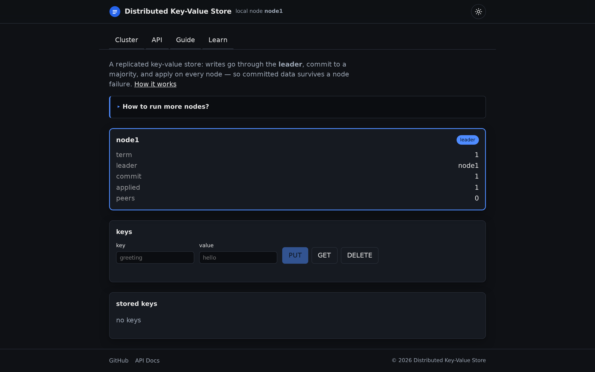
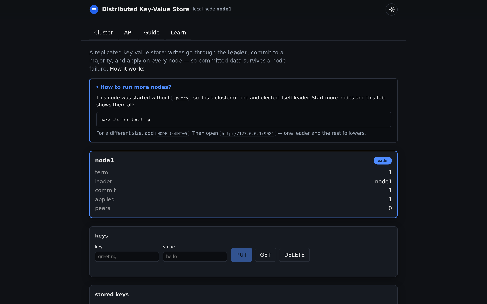
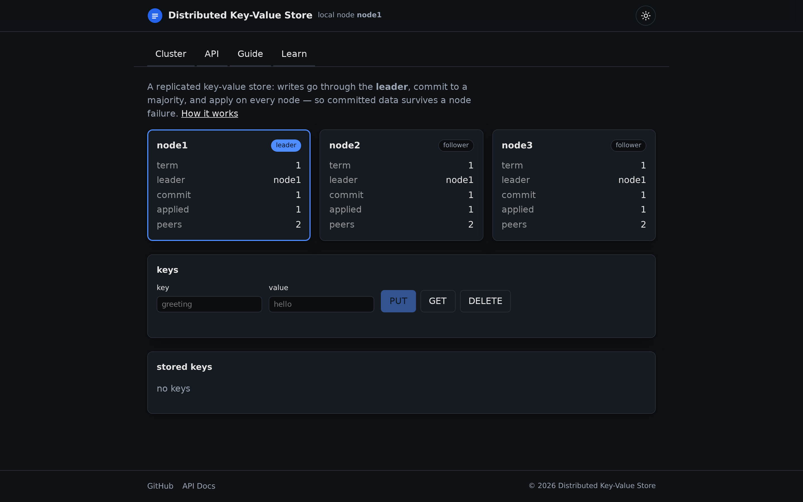
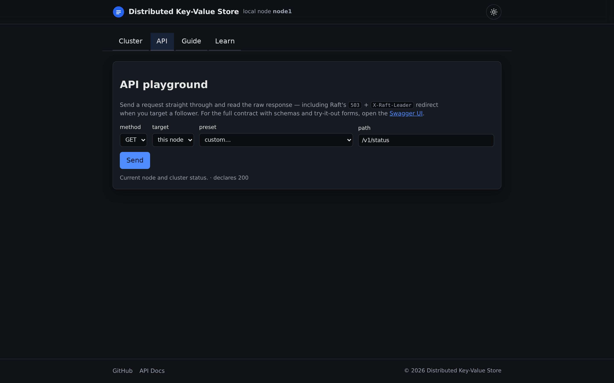
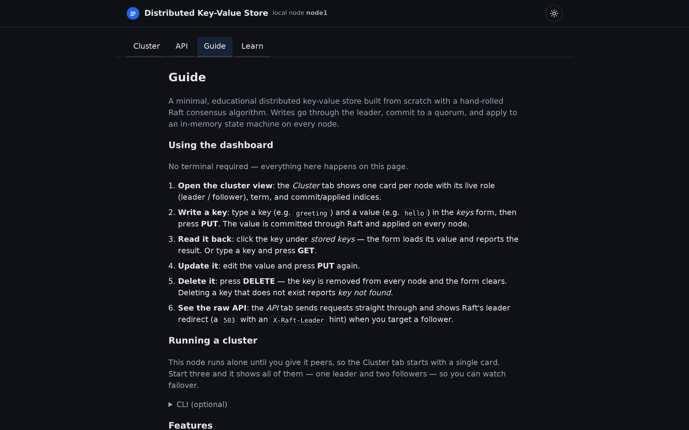
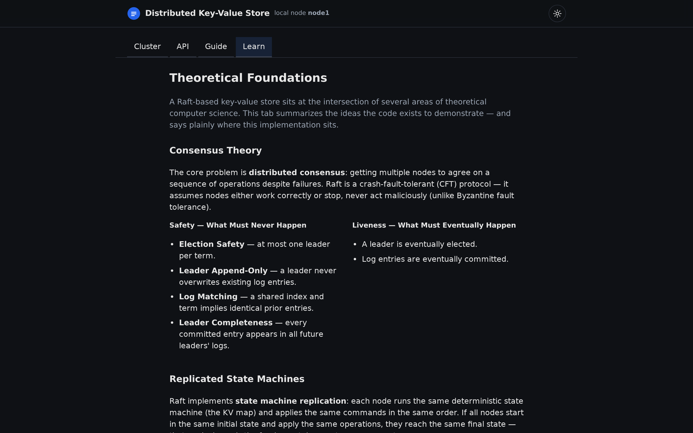
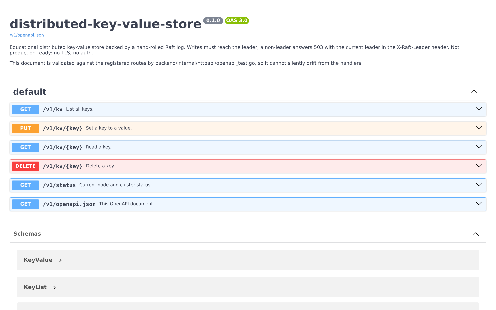
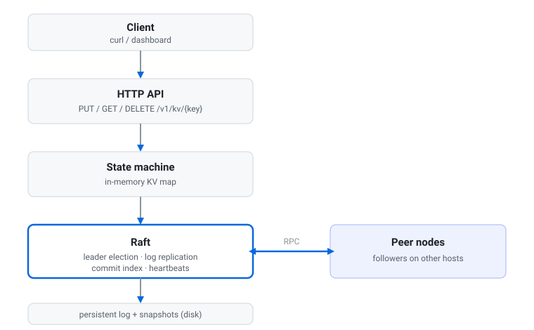
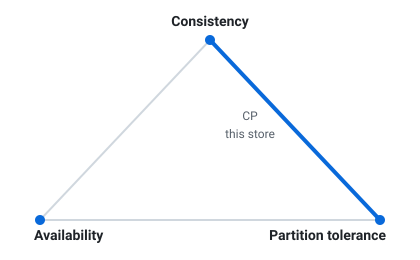
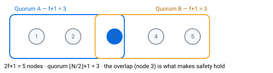

<div align="center">
  
  <h1>distributed-key-value-store</h1>
  <p><em>A minimal, educational distributed key-value store, built from scratch in Go with a hand-rolled Raft consensus algorithm.</em></p>
  <p>
    <a href="https://github.com/fiwon123/distributed-key-value-store/actions/workflows/ci.yml"></a>
    <a href="https://go.dev/"></a>
    <a href="LICENSE"></a>
  </p>
</div>

> **Educational project — not production-ready.** There is no TLS, no
> authentication, and no operational hardening. The goal is to understand how
> consensus keeps replicated state consistent through node failures, not to run
> this in front of real traffic.

## Table of contents

- [Problem](#problem)
- [What you can do](#what-you-can-do)
- [Status](#status)
- [Screenshots](#screenshots)
- [Prerequisites](#prerequisites)
- [How to use](#how-to-use)
- [Stack](#stack)
- [API](#api)
- [Dashboard](#dashboard)
- [Design choices](#design-choices)
- [Theoretical Foundations](#theoretical-foundations)
- [Build order](#build-order)
- [Done when](#done-when)
- [Development](#development)
- [Testing](#testing)
- [License](#license)
- [AI usage disclosure](#ai-usage-disclosure)

## Problem

A single-server key-value store loses availability when that server fails. To
keep reads and writes available across failures, several nodes must agree on the
order of writes. This project implements that agreement (Raft) from scratch and
drives a small key-value store with it.

## What you can do

Run a small cluster (three nodes by default) and:

- store, read, and delete keys over HTTP (`PUT`, `GET`, `DELETE`);
- inspect a node's role and state (`GET /v1/status`);
- kill the current leader and watch a new one get elected, with committed data
  still readable;
- explore the whole cluster from a dashboard embedded in every node.

## Status

**MVP complete.** Single-node KV, Raft leader election, log replication and
commit, on-disk log persistence with restart recovery, automatic snapshots and
log compaction, the `InstallSnapshot` RPC that catches up a follower behind the
compacted boundary, in-process leader-failure tests, the cluster dashboard, and a
runnable 3-node cluster (local processes or Docker Compose).

## Screenshots

### The cluster, on a single node



The **Cluster** tab leads with what the store is, then a card per node — role,
term, leader, and commit/applied indices — followed by a key/value console. On a
node with no peers, a collapsed **How to run more nodes?** callout explains how
to start a cluster.

### Running more nodes — the callout expanded



Expanding the callout gives the exact command to start a local cluster and the
URL to open. No commands to memorize from elsewhere.

### A three-node cluster



With peers configured, the same tab shows one card per node — here one leader and
two followers, all observed from a single browser tab through the node's
server-side peer proxy.

### The API playground



The **API** tab is a small playground. Its presets, allowed methods, and declared
status codes come from the node's own OpenAPI contract; it shows the raw response
including the `X-Raft-Leader` header, and it does not retry a `503`, so a
non-leader answer is visible as-is.

### The guide



The **Guide** tab is a command-free walkthrough of the dashboard and the three
ways to run a cluster (local processes, the smoke check, and Docker Compose).

### The Learn tab



The **Learn** tab explains the theory behind the code — see
[Theoretical Foundations](#theoretical-foundations).

### Swagger UI



Every node serves **Swagger UI** at `/docs`, generated from the same OpenAPI
contract that drives the playground, so you can exercise the endpoints by hand.

## Prerequisites

- **Go 1.26.9+** — the version pinned in [`go.mod`](go.mod).
- **Node.js 20+** — only needed to build the dashboard (CI uses 22). The node
  embeds a committed placeholder page, so `go build ./...` works without Node.
- **Docker** — optional, for the dev sandbox and the containerized cluster.

## How to use

### Run a single node

```bash
go run ./backend/cmd/kvnode -id node1 -http :8080
```

Open <http://localhost:8080> for the dashboard.

### Try basic operations

```bash
# Set a key (raw body, or JSON {"value":"..."})
curl -i -X PUT --data-binary 'hello' http://localhost:8080/v1/kv/greeting

# Read it back
curl -i http://localhost:8080/v1/kv/greeting

# Delete it
curl -i -X DELETE http://localhost:8080/v1/kv/greeting

# Node state
curl -i http://localhost:8080/v1/status
```

### Run a local 3-node cluster (no Docker)

A persistent, browsable cluster of local processes:

```bash
make cluster-local-up       # starts 3 nodes; prints the dashboard URLs
make cluster-local-status   # show each node's role
make cluster-local-down     # stop it
```

Three nodes start on `127.0.0.1:9081`–`:9083`, each with the others as peers, so
every node's dashboard shows all three cards — one leader, two followers. State
lives under `.cluster/` (gitignored) and each `up` starts fresh.

**Cluster sizing.** Start any number of nodes with `NODE_COUNT` (any size ≥ 1)
and move the starting port with `BASE_PORT`. Quorum is `⌊N/2⌋ + 1`, so even sizes
are safe — a 4-node cluster needs 3 of 4 to commit:

```bash
make cluster-local-up NODE_COUNT=5            # five nodes on :9081–:9085
make cluster-local-up NODE_COUNT=4 BASE_PORT=9100
```

**The failure check** — `make cluster-smoke` (or `scripts/cluster-smoke.sh`)
starts three nodes, writes a key, kills the leader, waits for a new leader, and
reads the committed value back. Unlike `cluster-local-up`, it tears its nodes
down on exit. This is the project's "Done when" check.

### Run the containerized cluster (Docker)

The same topology via Compose ([`deploy/`](deploy)):

```bash
make cluster-up     # docker compose -f deploy/docker-compose.yml up -d --build
curl -s localhost:8081/v1/status   # node1 (also 8082, 8083)
make cluster-down
```

Peers are addressed by service name (`node2=http://node2:8080`) and each node
persists its log in a named volume, so a restart recovers it. Writes must reach
the current leader; a follower answers `503` with `X-Raft-Leader`. Kill the
leader container (`docker compose -f deploy/docker-compose.yml kill node1`) and a
survivor takes over.

### Explore the dashboard

Each node serves the dashboard at `/` (same origin as the API), with four tabs:
**Cluster**, **API**, **Guide**, and **Learn** — see [Screenshots](#screenshots)
and the [Dashboard](#dashboard) section below. Swagger UI is at `/docs` and the
raw contract at `/v1/openapi.json`.

## Stack

- **Language**: Go (standard toolchain)
- **Consensus**: hand-rolled Raft (educational)
- **Persistence**: Raft log and state-machine snapshots on disk (log compaction)
- **Dashboard**: React + Vite + TypeScript, embedded in the node binary
- **Cluster**: 3 nodes via local processes or Docker Compose
- **Testing**: standard `testing` package (`go test`); Vitest for the dashboard

## API

| Method | Path | Purpose |
|---|---|---|
| `PUT` | `/v1/kv/{key}` | Set `key` to a value (raw body, or JSON `{"value":"..."}`) |
| `GET` | `/v1/kv/{key}` | Read a value (404 if absent) |
| `DELETE` | `/v1/kv/{key}` | Delete a key (204, or 404 if absent) |
| `GET` | `/v1/status` | Node role, term, leader, commit index, last applied |
| `GET` | `/cluster` | Dashboard discovery: local node id + peer ids |
| `GET` | `/node/{id}/...` | Server-side proxy to a peer node's API |
| `GET` | `/v1/openapi.json` | OpenAPI 3 contract for this API (JSON) |
| `GET` | `/docs` | Swagger UI for the API (loads UI assets from a CDN) |

### Interactive API testing

Every node describes its own API and serves a Swagger UI page, so you can exercise
the endpoints from a browser instead of hand-writing `curl`:

```bash
go run ./backend/cmd/kvnode
# then open http://localhost:8080/docs and try PUT/GET/DELETE and /v1/status
```

The raw contract is at `/v1/openapi.json` — it works offline and in any tool
(Postman, Redoc, the Swagger editor). `/docs` loads the Swagger UI bundle from a
CDN, so that page itself needs network access. A Go test
(`backend/internal/httpapi/openapi_test.go`) fails if the spec and the registered
routes diverge, so the document cannot silently rot.

## Dashboard

Each node serves a small web dashboard at `/` (same origin as the API). It shows
every cluster node's role, term, leader, and commit/applied indices, and lets you
exercise `PUT`/`GET`/`DELETE` against the leader. The browser reaches peers
through a server-side `/node/{id}/` proxy, so nodes only need to be reachable
from each other — not from the browser.

The dashboard has four tabs: **Cluster** (the view above, including the
key/value console and a clickable list of stored keys), **API**, a small
playground where you pick a method, enter a path, and see the raw response —
including the status and the `X-Raft-Leader` header — **Guide**, a command-free
walkthrough, and **Learn**, the theory behind the code. The playground does not
retry a `503`, so a non-leader answer is visible as-is; it links to the Swagger UI
at `/docs` for the full contract.

The **Cluster** tab also states what the store is and, when a node runs without
peers, shows a collapsed **How to run more nodes?** callout that expands to the
command that starts a cluster. Multi-node runs show a card per node.

The playground is driven by the node's own contract: it reads
`GET /v1/openapi.json` and derives its endpoint presets, the methods allowed per
path, and the declared status codes it shows. If the spec cannot be fetched it
falls back to a built-in endpoint list and keeps working.

The dashboard's TypeScript types come from the same document, so the frontend
cannot drift from the handlers: `npm run codegen` (`make web-codegen`) turns
`backend/internal/httpapi/openapi.json` into
`frontend/src/api-types.gen.ts`, and `npm run build` runs it first.

Build it once; the node embeds the output:

```bash
make web-build    # vite build -> backend/internal/webui/dist (embedded via go:embed)
go run ./backend/cmd/kvnode -id node1 -http :8080
```

Without a build, the binary serves a committed placeholder page, so
`go build ./...` keeps working with no Node installed.

## Design choices

- **No sharding** — one keyspace, replicated to every node (3-node quorum).
- **The log is the write-ahead log** — every change goes through the Raft log;
  applying committed entries updates an in-memory map.
- **Leader reads (MVP)** — reads go to the leader to avoid stale reads early on.
- **Quorum loss stops writes** — a leader that cannot reach a majority rejects
  writes rather than best-effort accepting them.
- **Automatic snapshots** — once a configurable number of entries (1000 by
  default) has been applied past the last snapshot, the state machine is
  snapshotted and the log prefix dropped, so the log does not grow without
  bound and restarts replay only the tail.
- **Snapshot catch-up** — a follower that falls behind the compacted log prefix
  is caught up with the leader's snapshot via the `InstallSnapshot` RPC instead
  of the missing entries.

## Theoretical Foundations

A Raft-based key-value store sits at the intersection of several areas of
theoretical computer science. This section summarizes the ideas the code exists
to demonstrate — and states plainly where this implementation sits.

### 1. Consensus Theory

The core problem is **distributed consensus**: getting multiple nodes to agree on
a sequence of operations despite failures. Raft is a crash-fault-tolerant (CFT)
protocol — it assumes nodes either work correctly or stop, never act maliciously
(unlike Byzantine fault tolerance).

**Safety properties** (what must never happen):

- **Election Safety** — at most one leader per term.
- **Leader Append-Only** — a leader never overwrites existing log entries.
- **Log Matching** — if two logs share an entry at the same index and term, all
  prior entries are identical.
- **Leader Completeness** — any committed entry appears in all future leaders'
  logs.

**Liveness properties** (what must eventually happen):

- A leader is eventually elected.
- Log entries are eventually committed.

### 2. Replicated State Machines

Raft implements **state machine replication**: each node runs the same
deterministic state machine (the KV map) and applies the same sequence of
commands in the same order. If all nodes start in the same initial state and
apply the same operations, they reach the same final state — that equivalence is
the fundamental correctness argument.



### 3. CAP Theorem

The CAP theorem (Brewer's theorem, formalized by Gilbert & Lynch, 2002) states
that during a **network partition** a system must choose between **C**onsistency
and **A**vailability (partition tolerance is not optional on a real network).
This store is a **CP** system: it keeps consistency and partition tolerance and
gives up availability when a majority is unreachable — writes are rejected
rather than accepted best-effort.



A refinement is **PACELC**: even when there is **E**lse no partition, there is a
tradeoff between **L**atency and **C**onsistency. Waiting for a majority
acknowledgement is slower than answering from a single node, but stronger.

### 4. Quorum / Majority Logic

The structural backbone is **quorum intersection**: in a cluster of `2f+1`
nodes, any two quorums of size `f+1` must overlap. That overlap is what
guarantees safety — no two conflicting leaders or commits can both succeed. With
N nodes the quorum this implementation requires is `⌊N/2⌋ + 1` (see
`Node.majority()`), which is correct for even sizes too, so even-sized clusters
cannot elect two leaders.



### 5. Consistency Models

| Model | Guarantee |
|---|---|
| Linearizability (strongest) | Operations appear to happen atomically in real-time order |
| Sequential consistency | Some global order consistent with each client's program order |
| Causal consistency | Preserves happens-before relationships |
| Eventual consistency (weakest) | All replicas converge eventually |

Raft naturally provides **linearizable writes** (committed entries are
totally ordered). Reads require additional mechanisms — ReadIndex or lease reads
— to also be linearizable; this MVP serves reads from the leader instead (see
[Design choices](#design-choices)).

### 6. Formal Verification & Model Checking

The Raft paper and implementations use **TLA+** (Leslie Lamport's specification
language) to specify and verify safety properties. Model checkers exhaustively
explore the state space to prove that no safety violation is possible.

### 7. The Asynchronous Model

Raft assumes an **asynchronous network** (no bound on message delay) and uses
randomized election timeouts to break symmetry. This connects to the **FLP
impossibility** result (Fischer, Lynch & Paterson, 1985): deterministic
consensus is impossible in a purely asynchronous system with even one crash
fault — randomized timeouts are the standard workaround.

> **In summary**, the theoretical pillars here are: consensus (safety +
> liveness), state machine replication, quorum arithmetic, CAP/PACELC tradeoffs,
> linearizability, and the asynchronous model with randomized liveness.

## Build order

1. Single-node: HTTP server + in-memory map, fully tested
2. Leader election: roles, timeouts, majority
3. Log replication: append entries, commit, apply
4. Persistence: log to disk + recovery on restart
5. Failure tests: kill the leader, confirm a new one is elected and data survives

## Done when

You can run three nodes locally, write a key, kill the leader, and still read the
committed value from the newly elected leader. `make cluster-smoke` checks this
end to end.

## Development

The Docker Compose **dev sandbox** gives you the full toolchain (Go, Node,
`gh`, `air` fast reload) with your host GitHub config mounted read-only and
`GH_TOKEN`/`GITHUB_TOKEN` forwarded at runtime — never baked into the image.

Copy the committed template to configure the sandbox (`.env` stays gitignored):

```bash
cp .env.example .env   # optional: HOST_PORT, HOST_HOME, GH_TOKEN/GITHUB_TOKEN, VITE_BACKEND
```

```bash
make dev-up        # build + start the sandbox (needs docker on the host)
make dev-restart   # restart after Dockerfile/deps changes
make shell         # shell inside the sandbox
make opencode      # run opencode inside the sandbox
make dev-down      # stop and remove the sandbox
make dev-log       # follow container logs
```

Direct toolchain (host or inside the sandbox):

```bash
go build ./...       # build
go test ./...        # test
go vet ./...         # static analysis
gofmt -l .           # formatting (empty output = clean)
make check           # all of the above (backend gate)

cd frontend
npm ci               # install frontend deps
npm run dev          # Vite dev server (proxies to a running node)
npm run codegen      # regenerate src/api-types.gen.ts from openapi.json
npm test             # frontend unit tests
make web-check       # frontend gate: install + lint + format:check + test + build
```

## Testing

**Backend** — standard library tests, plus the full local gate:

```bash
go test ./backend/internal/httpapi/ -v    # contract tests: drive requests from the OpenAPI spec; fail on spec↔handler drift
go test ./...                             # all unit tests
make check                                # gofmt -l, go vet, go test, go build
```

**Frontend** — Vitest + Testing Library (jsdom):

```bash
cd frontend && npm ci
npm test                # vitest
npm run test:watch      # watch mode while iterating
npm run lint
npm run format:check
make web-check          # install + lint + format:check + test + build
```

**End-to-end** — the multi-node failure check (also opt in to Go integration
tests with `make test-integration`):

```bash
make cluster-smoke      # write a key, kill the leader, read it from the new leader (Go + curl only)
make cluster-local-up   # start a persistent, browsable 3-node cluster (no docker)
make cluster-local-down # stop the local cluster
```

For manual API testing (Swagger UI, the raw spec, the dashboard playground, and
`curl` spot checks), see [Interactive API testing](#interactive-api-testing).

The project follows an issue-first, branch-based workflow — see
[`AGENTS.md`](AGENTS.md), [`PROJECT_CONTEXT.md`](PROJECT_CONTEXT.md), and
[`WORKFLOW_PROMPT.md`](WORKFLOW_PROMPT.md).

## License

[MIT](LICENSE) © 2026 Felipe Inoue.

## AI usage disclosure

This project was built with an AI coding agent ([opencode](https://opencode.ai))
making the Go and frontend changes, guided and reviewed by a human maintainer.
The agent followed the workflow documented in [`AGENTS.md`](AGENTS.md) — one
issue per change, a written plan, tests in the same pull request, and a review
before each merge.

Treat the result as educational, not audit-grade: review and verify it —
including the Raft safety argument — before reusing it anywhere that matters.
